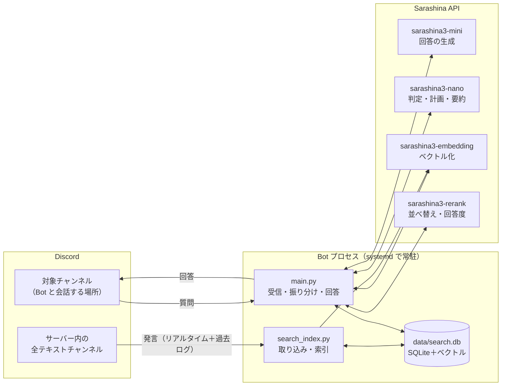
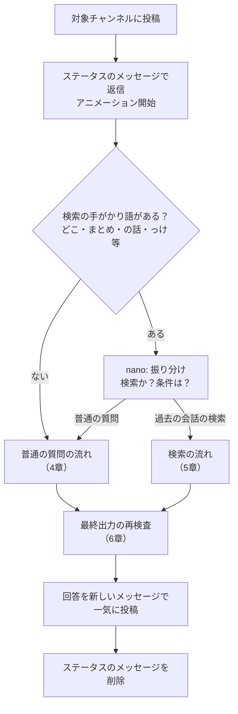
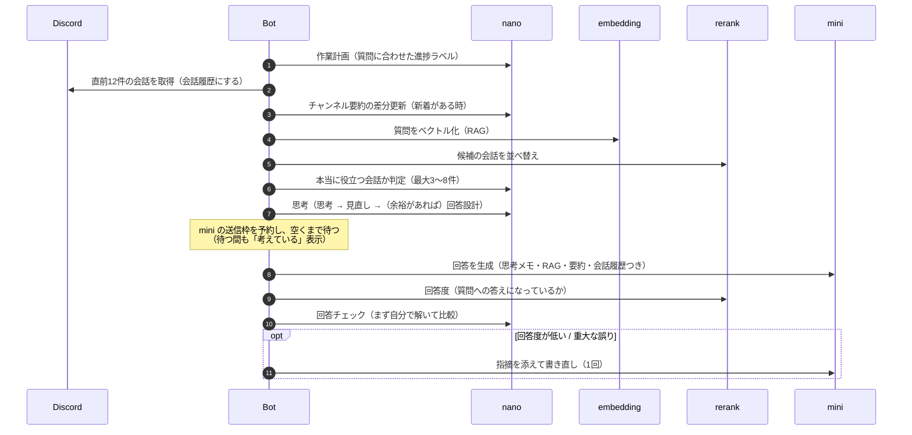
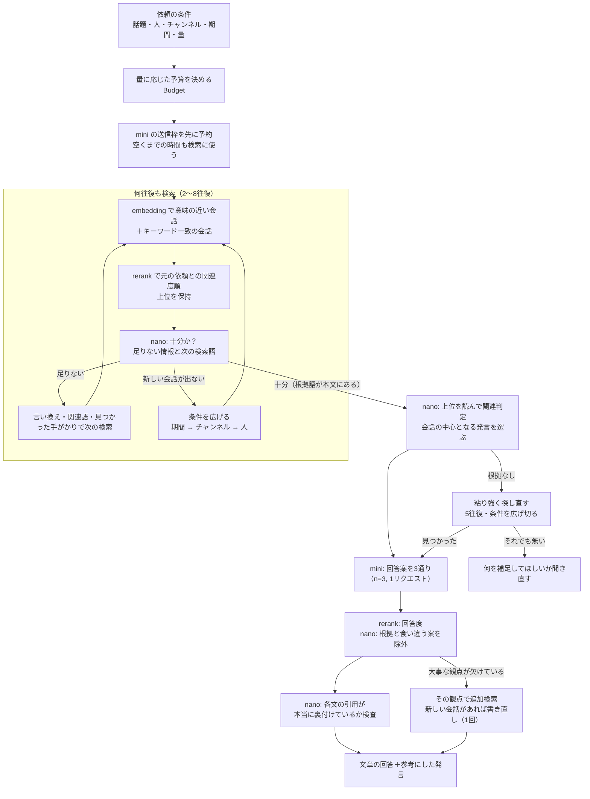
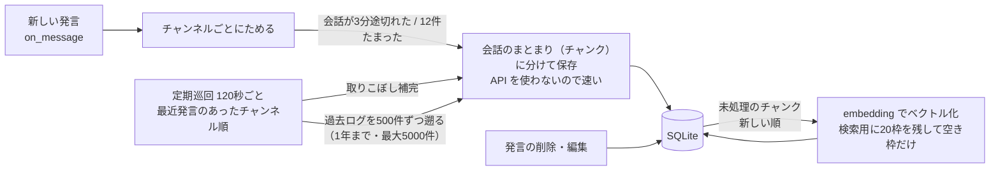

# Sarashina Discord Bot の仕組み

Discord のチャンネルに書き込まれた質問に、国産 LLM **Sarashina**（SB Intuitions）の API で答える Bot です。
「サーバーの過去の会話を背景に答える」ことを最重要にしており、普通の質問への回答と、過去ログの検索（RAG）の2系統で返答を作ります。

この文書は、**返答を生成するまでのデータの流れ**と、**各 API の役割**をまとめたものです。設定値の一覧は [README.md](../README.md) を参照してください。

---

## 1. 全体像



- **対象チャンネル**（`DISCORD_CHANNEL_IDS`）に書かれた投稿に Bot が返答する
- **サーバー内の全テキストチャンネル**の発言を裏で取り込み、検索・RAG の材料にする（Bot と会話するチャンネル自体は取り込まない）

---

## 2. Sarashina API の役割

Sarashina API で使えるモデルは6つ（mini / nano / guard / embedding / rerank / translate）。この Bot はそのうち4つを使う。
**長考（reasoning）モデルは無く**、ファイルを預けて検索してくれる仕組み（OpenAI の File Search / Vector Store のようなもの）も無い。そのため、部品を組み合わせて「考える」「検索する（RAG）」を作っている。

| モデル | レート制限 | この Bot での役割 |
|---|---|---|
| **sarashina3-mini** | **6 回/分**（最大のボトルネック） | 最終回答の生成だけに使う。検索の回答は `n=3` で**1リクエストに3通り**書かせる（消費は1回分） |
| **sarashina3-nano** | 60 回/分 | 「考える・判定する」役。振り分け、作業計画、チャンネル要約、思考、検索の継続判定、関連判定、回答案の審査、引用の検査、回答チェック |
| **sarashina3-embedding** | 60 回/分 | 会話（チャンク）と質問をベクトル化し、意味の近い会話を探す。1リクエスト1テキスト。256次元に切り詰めて保存 |
| **sarashina3-rerank** | 60 回/分 | ① 検索候補を「質問と同じ話題か」で並べ替える ② **回答度**（回答が質問への答えになっているか）を測る |
| sarashina3-guard / translate | 6 回/分 | 未使用 |

### API の性質で分かったこと（設計に影響したもの）

- 未定義のパラメータは 400 エラー（`max_tokens` は不可、`max_completion_tokens` を使う）
- `<think>` タグは API 側で除去される
- rerank のスコアは同じ話題だと 0.9999… に張り付く。**logit（log(p/(1-p))）に直すと「質問への答えになっているか」で差が出る**（答えている 13〜21 / 一部 10〜14 / 答えていない 2〜5）。一方、**事実の正誤は測れない**（誤った回答も 1.0）
- rerank のスコアは無関係な会話でも 0.9 を超えることがあり、しきい値としては使えない → 関連判定は nano にさせる
- 単に「誤りはあるか」と聞くと nano も mini も明らかな誤りを見逃す → 「まず自分で解いてから比べる」手順にすると見つけられる

---

## 3. 返答までの流れ（全体）



### 振り分け（`Searcher.route`）

1. **手がかり語チェック（コード）**：「どこ」「まとめ」「の話」「っけ」「発言」などを含まない投稿は、nano を呼ばずに普通の質問として扱う（Bot への感想が検索扱いになるのを防ぐ）。直前が検索結果なら「古すぎる」「もっと最近の」などの追加の依頼も検索として扱う
2. **nano（JSON モード）**：直前6件の会話・チャンネル名一覧・発言者名一覧を渡し、次を抽出する
   - 検索か普通の質問か / 場所を探す（locate）かまとめる（summarize）か
   - 話題・キーワード（表記ゆれ含む）・人（「山下」→ 一覧の「yama_spec」のように対応付け）・チャンネル・期間・新しい順か
   - **求める詳しさ・量**（「詳しく」→ detail、「複数」「全部」→ breadth、「3つ」→ count）
3. **コードでの補正**：人名＋一般語だけのクエリ（「山下の言動」）は話題なしに、勝手に付いた期間は外す、など

---

## 4. 普通の質問の流れ



### mini に渡すもの

| 部分 | 中身 | 目的 |
|---|---|---|
| システムプロンプト | 「質問は必ずこのサーバーの会話が背景」「答えを最初に」「決まり文句・大げさな表現を使わない」等 | 回答の方針 |
| ＋チャンネルの要約 | nano が差分更新している、少し前までの会話の要約 | 古めの背景（関係する時だけ使う） |
| ＋過去の関連する会話（RAG） | `[参1]` 付きの会話（最大3件、「全部」等なら最大8件） | サーバー全体の知識 |
| ＋思考メモ | nano の「思考・見直し・回答設計」 | 回答の下書き（mini が検証して使う） |
| 会話履歴 | 直前12件をそのまま（他の人は「名前: 本文」、Bot は assistant）。過去の回答の参考一覧は除去済み | 「それ」「さっきの」の解釈 |
| 最後のユーザー発言 | 質問＋短い確認（前置き禁止・指示語の対象を先に特定） | 小さいモデルは末尾の指示ほど守る |

### 回答のチェック（`check_and_revise`）

1. **回答度**（rerank GENERAL_QA の logit）が 7 未満 → 「質問に直接答えていない」
2. **nano のチェック**：「回答案を見ずにまず自分で解く → 比べる」手順で、事実・計算の誤り、質問の取り違え、根拠のない最新情報の断定を探す
3. どちらかで問題があれば、指摘を添えて mini が1回だけ書き直す

---

## 5. 検索（RAG）の流れ

「〇〇の話どこだっけ？」「〇〇について話してた内容をまとめて」のような依頼。**十分な情報が集まるまで何往復も検索し、回答案を複数書いて一番良いものを選ぶ**。



### 1往復でやること（`_deep_search`）

1. **集める**（`_gather`）：検索語を embedding でベクトル化し、意味の近い会話（チャンク）を取得。あわせて SQLite でキーワードを含む会話も取得（英字は単語単位で照合）
2. **並べる**（`_rank`）：rerank で「元の依頼との関連度」順に並べ、上位（通常24件、「全部」なら48件）だけ保持
3. **判定する**（`_next_queries`）：nano が「見つかった会話で依頼に十分答えられるか」を判定し、足りなければ「足りない情報」と次の検索語（言い換え・関連語・見つかった会話に出てきた手がかり）を最大2つ出す
4. **広げる**：言い換えでも新しい会話が見つからなくなったら、期間 → チャンネル → 人の順に条件を外す

「十分」は、nano の判定に加えて **元の話題の語（表記ゆれ含む）が実際に本文に出てくる**ときだけ。意味が近いだけの会話では止めない。

### 量・詳しさに応じた予算（`Budget`）

| 依頼 | 使う会話 | 往復 | 候補の保持 | 関連判定 | 回答に渡す量 | 書き方 |
|---|---|---|---|---|---|---|
| 通常 | 5件 | 2〜6 | 24件 | 10件 | 12,000字 | 1人2件まで |
| 「複数」「いくつか」 | 8件 | 3〜7 | 32件 | 14件 | 16,000字 | 複数挙げる（1人3件まで） |
| 「全部」「一覧」 | 12件 | 4〜8 | 48件 | 20件 | 24,000字 | 漏れなく列挙（人数制限なし） |
| 「詳しく」 | ＋往復1回 | | | | 1.5倍 | 経緯・理由・具体的な発言まで |
| 「3つ」 | 数＋2件以上 | | | | | その件数を目安に |

### 回答の作り方（`Searcher.compose`）

1. 見つかった会話を時系列に並べ、各発言に `[番号]` を付ける（まとめる場合は前後の会話も読み足す）
2. **mini に回答案を3通り書かせる**（`n=3`。質問の背景としてチャンネルの直前の会話も渡す）
3. **回答度**（rerank）で「質問への答えになっているか」を測る
4. **nano（審査員）** が根拠の会話と回答案を読み比べ、根拠と食い違う案を挙げ、一番直接答えている案を推す
5. 食い違う案を除き、回答度が最も高い案を採用（審査員の推しが僅差なら審査員を優先）
6. 審査で「大事な観点が欠けている」なら、その観点で追加検索し、新しい会話があれば書き直す（1回）

### 聞き直すのは最終手段

1. 通常の検索で根拠があれば、そのまま答える（直接の言及が無くても関係する話があれば「直接の言及はありませんが、〜」の形で答える）
2. 根拠が足りなければ、**十分かどうかに関わらず5往復・条件を広げ切って**粘り強く探し直す
3. それでも関係する会話が1件も無いときだけ、何を補足してほしいか聞き直す

### 出力の形

```
（依頼への答えを文章で。根拠には [1] [2] のような短い番号）

-# 参考にした発言
-# [1] #チャンネル 日時 発言者「発言の抜粋…」[→ 移動](発言へのリンク)
```

---

## 6. 最終出力の再検査（`output_check.py`）

実際に起きた不具合（存在しないリンクの捏造、`[1]…[478]` の暴走、重複、過剰な引用）への対策。

| 段階 | 処理 |
|---|---|
| 会話履歴を作るとき | 過去の Bot の回答から参考一覧・引用番号・リンクを除去（`strip_references`）。モデルが真似して捏造するのを防ぐ |
| モデルの生出力 | モデルが書いた参考一覧・Discord リンクは捏造なので除去、引用番号の連続は3つまで、同じ文字列の繰り返しは1回に（`clean_model_output`） |
| 検索の回答 | nano が各文と引用された発言を読み比べ、その文を実際に裏付けている番号だけ残す（1文最大3つ）（`verify_citations`） |
| 参考一覧を付けるとき | 同じ発言は1つの番号にまとめ、一覧に載らない番号は本文からも除去（`cite`）。**参考一覧とリンクはシステムだけが付ける** |
| 普通の回答 | 「ご質問の意図を理解しました。〜についてですね。」等の決まり文句の書き出しを除去（`strip_stock_openers`） |

---

## 7. 過去ログの取り込み（`search_index.py`）



- **保存とベクトル化を分けている**：embedding は1リクエスト1テキスト・60回/分なので、ベクトル化を待つと全チャンネルが揃うまで何時間もかかる。保存は API 不要で全36チャンネル約7,000件が約2分。保存した時点でキーワード検索の対象になり、ベクトル化は新しい会話から順に進む
- **チャンク**：時間的に連続した最大12件・1200文字の発言（15分以上空いたら区切る）。短い発言1件ずつでは意味が取りにくいため
- ベクトルは先頭256次元に切り詰めて正規化（精度はほぼ同じで軽い）。numpy の行列としてメモリに持ち、内積で検索
- Bot の発言・Bot と会話するチャンネルは取り込まない（依頼文が検索結果を汚すため）
- 検索結果は**質問した人が閲覧できるチャンネルだけ**から返す

---

## 8. レート制限の扱い

- **予約制のレートリミッター**（`RateLimiter.reserve`）：モデルごとに「自分の番が何秒後か」を事前に計算し、その時刻ちょうどに送る。通常は 429 エラーにならない
- **mini（6回/分）を最終回答にだけ使う**：考える・判定するのは nano（60回/分）。検索の回答案3通りは `n=3` で1リクエスト
- **待ち時間を無駄にしない**：普通の質問では mini の枠が空くまで nano の思考を続け、検索では枠が空くまで検索を続けて情報を厚くする
- **埋め込みは検索を優先**：取り込み（ベクトル化）は20枠を検索用に残し、空き枠だけを使う

### 1質問あたりの API 呼び出し（目安）

| 種類 | mini | nano | embedding | rerank |
|---|---|---|---|---|
| 普通の質問 | 1（書き直し時 2） | 5〜8（計画・要約・RAG 判定・思考×1〜3・チェック、振り分けは手がかり語がある時） | 1（RAG） | 2（RAG・回答度） |
| 検索 | 1（書き直し時 2） | 往復数＋4程度（振り分け・往復ごとの判定・関連判定・審査・引用検査） | 往復ごとに1〜2 | 往復ごとに1〜2＋回答度 |

---

## 9. 処理中の表示（`thinking.py`）

回答が完成するまで、ステータスのメッセージを約1.2秒ごとに描き直す（`Animator`）。

```
⠙ 💭 方程式を立てて考えています..
-# ✅ 集める → ⠙ 考える → ▫️ 確かめる → ▫️ 書く
-# ▰▰▱▱▱▱▱▱▱▱▱▱▱▱ 1秒 · すずきさんの「Bさんの年齢」
-# 📎 #チャット の過去の会話を2件見つけました
```

- 1行目：質問ごとに nano が立てた**作業計画のラベル**（「勉強会の日程の発言を探しています」など）。検索中は「今どういう検索をしているか」の一言コメントを**10秒に1回まで**切り替える
- 2行目：4段階（集める → 考える → 確かめる → 書く）の進み具合
- 3行目：進捗バー・経過秒数・残り時間（mini の順番待ちのとき）・誰のどの質問か
- 4行目以降：見つかった会話や状況のメモ
- mini の順番待ちの間も「見つかった会話を読み比べています」のような思考ラベルを出す
- 完成したら回答を**新しいメッセージで一気に**投稿し、ステータスのメッセージは削除（チャンネルには回答だけが残る）

---

## 10. ファイル構成

| ファイル | 役割 |
|---|---|
| `bot/main.py` | Discord の受信、振り分け、普通の質問の流れ（思考・回答・チェック）、検索の流れの制御、投稿、起動時の片付け |
| `bot/sarashina.py` | Sarashina API クライアント（`chat` / `chat_many`（n 通り）/ `chat_stream` / `embed` / `rerank` / `answer_scores`（回答度））と予約制レートリミッター |
| `bot/search.py` | 振り分け（`route`）、量の読み取り（`read_scope` / `Budget`）、何往復もする検索（`_deep_search`）、RAG（`related`）、回答案の作成と審査（`compose`）、聞き直し（`clarify`）、参考一覧（`cite`） |
| `bot/search_index.py` | SQLite の索引（発言・チャンク・ベクトル）と、取り込み（`Indexer`: リアルタイム・巡回・ベクトル化） |
| `bot/context.py` | チャンネル要約（nano で差分更新）と、直前の会話の会話履歴化（`recent_turns`） |
| `bot/thinking.py` | 思考プロンプト、作業計画、処理中ステータスの描画とアニメーション |
| `bot/output_check.py` | 最終出力の再検査（捏造リンク・参考一覧の除去、引用の裏付け検査、暴走の抑制） |
| `data/search.db` | 索引（Git 管理外） |
| `logs/bot.log` | ログ（日次ローテーション、7日で自動削除） |
